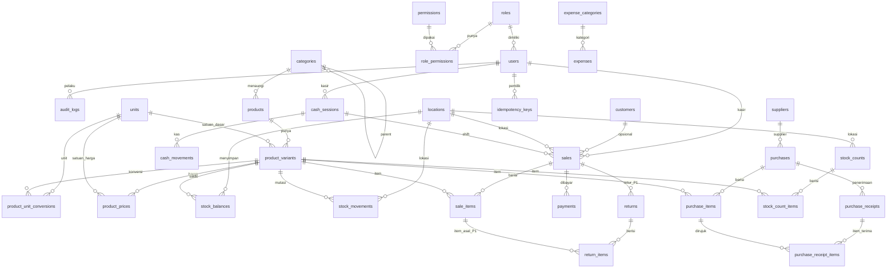

# ERD & Rancangan Database — Sistem POS Toko Plastik

**Dokumen:** `erd.md`
**Status:** Baseline desain MVP (P0) + rancangan P1
**Sumber:** `production.md` Bagian 7, `decisions.md`
**Versi:** 1.0

Dokumen ini mendefinisikan struktur database PostgreSQL. Nama kolom di sini adalah baseline untuk migration; normalisasi final dipastikan saat Alembic migration pertama dibuat.

**Konvensi:**
- Semua PK menggunakan `UUID` (default `gen_random_uuid()`).
- Uang: `NUMERIC(18,2)`. Kuantitas/faktor: `NUMERIC(18,4)`.
- Waktu: `TIMESTAMPTZ` (disimpan UTC).
- Kolom audit umum: `created_at`, `updated_at`.
- Penanda **[P1]** berarti dirancang sekarang, diimplementasikan setelah MVP.

---

## 1. Diagram Relasi (Mermaid)

---

## 2. Autentikasi, Pengguna, dan RBAC (P0)

### 2.1 `roles`

| Kolom | Tipe | Aturan |
|---|---|---|
| `id` | UUID | PK |
| `name` | VARCHAR(50) | UNIQUE, NOT NULL (`owner`, `admin`, `cashier`, `warehouse`) |
| `description` | TEXT | NULL |
| `is_system` | BOOLEAN | NOT NULL DEFAULT false (role bawaan tidak boleh dihapus) |

### 2.2 `permissions`

| Kolom | Tipe | Aturan |
|---|---|---|
| `id` | UUID | PK |
| `code` | VARCHAR(100) | UNIQUE, NOT NULL (contoh `product.update`, `price.update`, `sale.void`) |
| `description` | TEXT | NULL |

### 2.3 `role_permissions`

| Kolom | Tipe | Aturan |
|---|---|---|
| `role_id` | UUID | FK `roles.id`, bagian PK |
| `permission_id` | UUID | FK `permissions.id`, bagian PK |

PK gabungan `(role_id, permission_id)`.

### 2.4 `users`

| Kolom | Tipe | Aturan |
|---|---|---|
| `id` | UUID | PK |
| `name` | VARCHAR(150) | NOT NULL |
| `username` | VARCHAR(100) | UNIQUE, NOT NULL |
| `email` | VARCHAR(150) | UNIQUE, NULL |
| `password_hash` | VARCHAR(255) | NOT NULL |
| `role_id` | UUID | FK `roles.id`, NOT NULL |
| `is_active` | BOOLEAN | NOT NULL DEFAULT true |
| `failed_login_count` | INT | NOT NULL DEFAULT 0 |
| `locked_until` | TIMESTAMPTZ | NULL |
| `last_login_at` | TIMESTAMPTZ | NULL |
| `created_at`, `updated_at` | TIMESTAMPTZ | NOT NULL |

### 2.5 `audit_logs` (P0)

| Kolom | Tipe | Aturan |
|---|---|---|
| `id` | UUID | PK |
| `actor_id` | UUID | FK `users.id`, NULL (NULL = sistem) |
| `action` | VARCHAR(100) | NOT NULL (contoh `sale.void`, `price.update`) |
| `entity_type` | VARCHAR(100) | NOT NULL |
| `entity_id` | UUID | NULL |
| `metadata` | JSONB | NULL (jangan simpan password/token) |
| `ip_address` | INET | NULL |
| `created_at` | TIMESTAMPTZ | NOT NULL, index |

### 2.6 `idempotency_keys` (P0)

| Kolom | Tipe | Aturan |
|---|---|---|
| `id` | UUID | PK |
| `key` | VARCHAR(150) | UNIQUE, NOT NULL |
| `user_id` | UUID | FK `users.id`, NOT NULL |
| `endpoint` | VARCHAR(150) | NOT NULL |
| `request_hash` | VARCHAR(64) | NOT NULL |
| `status_code` | INT | NULL |
| `response_body` | JSONB | NULL |
| `created_at` | TIMESTAMPTZ | NOT NULL |
| `expires_at` | TIMESTAMPTZ | NULL, index |

---

## 3. Pengaturan & Lokasi (P0)

### 3.1 `store_settings` (satu baris)

| Kolom | Tipe | Aturan |
|---|---|---|
| `id` | UUID | PK |
| `store_name` | VARCHAR(150) | NOT NULL |
| `address` | TEXT | NULL |
| `phone` | VARCHAR(30) | NULL |
| `email` | VARCHAR(150) | NULL |
| `logo_url` | TEXT | NULL |
| `receipt_header` | TEXT | NULL |
| `receipt_footer` | TEXT | NULL |
| `timezone` | VARCHAR(50) | NOT NULL DEFAULT `Asia/Jakarta` |
| `currency` | VARCHAR(3) | NOT NULL DEFAULT `IDR` |
| `invoice_prefix_sale` | VARCHAR(10) | NOT NULL DEFAULT `SLS` |
| `invoice_prefix_purchase` | VARCHAR(10) | NOT NULL DEFAULT `PUR` |
| `invoice_prefix_return` | VARCHAR(10) | NOT NULL DEFAULT `RTR` |
| `discount_max_percent_cashier` | NUMERIC(5,2) | NOT NULL DEFAULT 0 |
| `allow_negative_stock` | BOOLEAN | NOT NULL DEFAULT false |
| `updated_at` | TIMESTAMPTZ | NOT NULL |

### 3.2 `locations` (satu baris default)

| Kolom | Tipe | Aturan |
|---|---|---|
| `id` | UUID | PK |
| `name` | VARCHAR(100) | NOT NULL |
| `code` | VARCHAR(20) | UNIQUE, NOT NULL |
| `is_default` | BOOLEAN | NOT NULL DEFAULT false |
| `is_active` | BOOLEAN | NOT NULL DEFAULT true |

### 3.3 `document_counters`

Counter nomor dokumen unik per prefix/periode.

| Kolom | Tipe | Aturan |
|---|---|---|
| `prefix` | VARCHAR(10) | bagian PK |
| `period` | VARCHAR(6) | bagian PK (`YYYYMM`) |
| `last_number` | INT | NOT NULL DEFAULT 0 |

---

## 4. Master Data Produk (P0)

### 4.1 `categories`

| Kolom | Tipe | Aturan |
|---|---|---|
| `id` | UUID | PK |
| `name` | VARCHAR(100) | NOT NULL |
| `parent_id` | UUID | FK `categories.id`, NULL |
| `is_active` | BOOLEAN | NOT NULL DEFAULT true |

### 4.2 `products`

| Kolom | Tipe | Aturan |
|---|---|---|
| `id` | UUID | PK |
| `name` | VARCHAR(200) | NOT NULL |
| `category_id` | UUID | FK `categories.id`, NULL |
| `brand` | VARCHAR(100) | NULL |
| `description` | TEXT | NULL |
| `is_active` | BOOLEAN | NOT NULL DEFAULT true |
| `created_at`, `updated_at` | TIMESTAMPTZ | NOT NULL |

### 4.3 `units`

| Kolom | Tipe | Aturan |
|---|---|---|
| `id` | UUID | PK |
| `name` | VARCHAR(50) | NOT NULL (contoh `Lembar`, `Pak`, `Bal`) |
| `symbol` | VARCHAR(10) | NOT NULL |
| `allows_fraction` | BOOLEAN | NOT NULL DEFAULT false |

### 4.4 `product_variants`

Satu baris = item yang punya SKU/stok/harga sendiri.

| Kolom | Tipe | Aturan |
|---|---|---|
| `id` | UUID | PK |
| `product_id` | UUID | FK `products.id`, NOT NULL |
| `sku` | VARCHAR(100) | UNIQUE, NOT NULL |
| `barcode` | VARCHAR(100) | UNIQUE, NULL |
| `attribute_size` | VARCHAR(100) | NULL |
| `attribute_color` | VARCHAR(100) | NULL |
| `attribute_thickness` | VARCHAR(100) | NULL |
| `attribute_type` | VARCHAR(100) | NULL |
| `attribute_packaging` | VARCHAR(100) | NULL |
| `base_unit_id` | UUID | FK `units.id`, NOT NULL |
| `min_stock` | NUMERIC(18,4) | NULL, CHECK ≥ 0 |
| `cost_method` | VARCHAR(20) | NOT NULL DEFAULT `moving_average` |
| `is_active` | BOOLEAN | NOT NULL DEFAULT true |
| `created_at`, `updated_at` | TIMESTAMPTZ | NOT NULL |

### 4.5 `product_unit_conversions`

| Kolom | Tipe | Aturan |
|---|---|---|
| `id` | UUID | PK |
| `variant_id` | UUID | FK `product_variants.id`, NOT NULL |
| `unit_id` | UUID | FK `units.id`, NOT NULL |
| `base_units_per_unit` | NUMERIC(18,4) | NOT NULL, CHECK > 0 |
| `is_active` | BOOLEAN | NOT NULL DEFAULT true |

UNIQUE `(variant_id, unit_id)`. Satuan dasar juga harus tercatat sebagai konversi dengan nilai `1` (memudahkan perhitungan seragam).

### 4.6 `product_prices`

| Kolom | Tipe | Aturan |
|---|---|---|
| `id` | UUID | PK |
| `variant_id` | UUID | FK `product_variants.id`, NOT NULL |
| `unit_id` | UUID | FK `units.id`, NOT NULL |
| `min_qty` | NUMERIC(18,4) | NOT NULL, CHECK ≥ 0 |
| `max_qty` | NUMERIC(18,4) | NULL, CHECK (max is null or max ≥ min) |
| `unit_price` | NUMERIC(18,2) | NOT NULL, CHECK ≥ 0 |
| `valid_from` | TIMESTAMPTZ | NULL |
| `valid_to` | TIMESTAMPTZ | NULL |
| `is_active` | BOOLEAN | NOT NULL DEFAULT true |

Aturan anti-tumpang-tindih rentang `(variant_id, unit_id, min_qty, max_qty)` divalidasi di service; jika memungkinkan, gunakan `EXCLUDE USING gist` dengan `numrange`.

### 4.7 `price_histories` (P0)

| Kolom | Tipe | Aturan |
|---|---|---|
| `id` | UUID | PK |
| `variant_id` | UUID | FK, NOT NULL |
| `unit_id` | UUID | FK, NOT NULL |
| `old_price` | NUMERIC(18,2) | NULL |
| `new_price` | NUMERIC(18,2) | NOT NULL |
| `changed_by` | UUID | FK `users.id`, NOT NULL |
| `created_at` | TIMESTAMPTZ | NOT NULL |

---

## 5. Mitra (P0/P1)

### 5.1 `suppliers` (P0 struktur, CRUD P1)

| Kolom | Tipe | Aturan |
|---|---|---|
| `id` | UUID | PK |
| `name` | VARCHAR(150) | NOT NULL |
| `contact_name` | VARCHAR(150) | NULL |
| `phone` | VARCHAR(30) | NULL |
| `email` | VARCHAR(150) | NULL |
| `address` | TEXT | NULL |
| `notes` | TEXT | NULL |
| `is_active` | BOOLEAN | NOT NULL DEFAULT true |

### 5.2 `customers` (P0 struktur, tanpa piutang)

| Kolom | Tipe | Aturan |
|---|---|---|
| `id` | UUID | PK |
| `name` | VARCHAR(150) | NOT NULL |
| `phone` | VARCHAR(30) | NULL |
| `email` | VARCHAR(150) | NULL |
| `address` | TEXT | NULL |
| `notes` | TEXT | NULL |
| `is_active` | BOOLEAN | NOT NULL DEFAULT true |

> Tidak ada tabel piutang/pelunasan pada MVP.

---

## 6. Persediaan (P0)

### 6.1 `stock_balances`

| Kolom | Tipe | Aturan |
|---|---|---|
| `id` | UUID | PK |
| `variant_id` | UUID | FK `product_variants.id`, NOT NULL |
| `location_id` | UUID | FK `locations.id`, NOT NULL |
| `quantity` | NUMERIC(18,4) | NOT NULL DEFAULT 0 (dalam satuan dasar) |
| `avg_cost` | NUMERIC(18,4) | NOT NULL DEFAULT 0 (moving weighted average per satuan dasar) |
| `updated_at` | TIMESTAMPTZ | NOT NULL |

UNIQUE `(variant_id, location_id)`. Baris di-lock dengan `SELECT ... FOR UPDATE` saat transaksi.

### 6.2 `stock_movements` (append-only)

| Kolom | Tipe | Aturan |
|---|---|---|
| `id` | UUID | PK |
| `variant_id` | UUID | FK, NOT NULL |
| `location_id` | UUID | FK, NOT NULL |
| `type` | VARCHAR(30) | NOT NULL: `opening`, `purchase_receipt`, `sale`, `sale_return`, `purchase_return`, `adjustment_in`, `adjustment_out`, `damaged`, `void` |
| `quantity` | NUMERIC(18,4) | NOT NULL (bertanda; + masuk, − keluar) |
| `unit_cost` | NUMERIC(18,4) | NULL (biaya per satuan dasar saat masuk) |
| `balance_after` | NUMERIC(18,4) | NOT NULL |
| `reference_type` | VARCHAR(30) | NULL (`sale`, `purchase_receipt`, `adjustment`, `stock_count`, ...) |
| `reference_id` | UUID | NULL |
| `user_id` | UUID | FK `users.id`, NULL |
| `reason` | TEXT | NULL |
| `created_at` | TIMESTAMPTZ | NOT NULL, index `(variant_id, created_at)` |

### 6.3 `stock_adjustments` (P0)

| Kolom | Tipe | Aturan |
|---|---|---|
| `id` | UUID | PK |
| `number` | VARCHAR(30) | UNIQUE, NOT NULL |
| `location_id` | UUID | FK, NOT NULL |
| `variant_id` | UUID | FK, NOT NULL |
| `adjustment_type` | VARCHAR(20) | NOT NULL: `increase` / `decrease` |
| `quantity` | NUMERIC(18,4) | NOT NULL, CHECK > 0 (satuan dasar) |
| `reason` | TEXT | NOT NULL |
| `created_by` | UUID | FK `users.id`, NOT NULL |
| `created_at` | TIMESTAMPTZ | NOT NULL |

### 6.4 `stock_counts` (P0)

| Kolom | Tipe | Aturan |
|---|---|---|
| `id` | UUID | PK |
| `number` | VARCHAR(30) | UNIQUE, NOT NULL |
| `location_id` | UUID | FK, NOT NULL |
| `status` | VARCHAR(20) | NOT NULL: `draft`, `counting`, `confirmed`, `cancelled` |
| `created_by` | UUID | FK `users.id`, NOT NULL |
| `confirmed_by` | UUID | FK `users.id`, NULL |
| `confirmed_at` | TIMESTAMPTZ | NULL |
| `notes` | TEXT | NULL |
| `created_at` | TIMESTAMPTZ | NOT NULL |

### 6.5 `stock_count_items`

| Kolom | Tipe | Aturan |
|---|---|---|
| `id` | UUID | PK |
| `stock_count_id` | UUID | FK, NOT NULL |
| `variant_id` | UUID | FK, NOT NULL |
| `system_quantity` | NUMERIC(18,4) | NOT NULL (snapshot saat mulai) |
| `counted_quantity` | NUMERIC(18,4) | NULL |
| `difference` | NUMERIC(18,4) | NULL |
| `unit_id` | UUID | FK `units.id`, NOT NULL |
| `notes` | TEXT | NULL |

UNIQUE `(stock_count_id, variant_id)`. Konfirmasi opname membuat `stock_movements` penyesuaian dalam satu transaksi DB.

---

## 7. Penjualan (P0)

### 7.1 `cash_sessions`

| Kolom | Tipe | Aturan |
|---|---|---|
| `id` | UUID | PK |
| `location_id` | UUID | FK, NOT NULL |
| `cashier_id` | UUID | FK `users.id`, NOT NULL |
| `opened_at` | TIMESTAMPTZ | NOT NULL |
| `closed_at` | TIMESTAMPTZ | NULL |
| `opening_cash` | NUMERIC(18,2) | NOT NULL DEFAULT 0 |
| `expected_cash` | NUMERIC(18,2) | NULL |
| `counted_cash` | NUMERIC(18,2) | NULL |
| `difference` | NUMERIC(18,2) | NULL |
| `status` | VARCHAR(20) | NOT NULL: `open`, `closed` |
| `notes` | TEXT | NULL |
| `closed_by` | UUID | FK `users.id`, NULL |

Index unik parsial untuk mencegah dua shift `open` per kasir/lokasi (opsional).

### 7.2 `cash_movements`

| Kolom | Tipe | Aturan |
|---|---|---|
| `id` | UUID | PK |
| `cash_session_id` | UUID | FK, NOT NULL |
| `type` | VARCHAR(20) | NOT NULL: `opening`, `cash_in`, `cash_out`, `sale_cash`, `refund` |
| `amount` | NUMERIC(18,2) | NOT NULL (bertanda) |
| `reason` | TEXT | NULL |
| `reference_type` | VARCHAR(30) | NULL |
| `reference_id` | UUID | NULL |
| `user_id` | UUID | FK `users.id`, NOT NULL |
| `created_at` | TIMESTAMPTZ | NOT NULL |

### 7.3 `sales`

| Kolom | Tipe | Aturan |
|---|---|---|
| `id` | UUID | PK |
| `number` | VARCHAR(30) | UNIQUE, NOT NULL |
| `location_id` | UUID | FK, NOT NULL |
| `cashier_id` | UUID | FK `users.id`, NOT NULL |
| `cash_session_id` | UUID | FK `cash_sessions.id`, NOT NULL |
| `customer_id` | UUID | FK `customers.id`, NULL |
| `status` | VARCHAR(20) | NOT NULL: `completed`, `voided` |
| `subtotal` | NUMERIC(18,2) | NOT NULL (sebelum diskon) |
| `discount_total` | NUMERIC(18,2) | NOT NULL DEFAULT 0 |
| `tax_total` | NUMERIC(18,2) | NOT NULL DEFAULT 0 |
| `total` | NUMERIC(18,2) | NOT NULL |
| `paid_total` | NUMERIC(18,2) | NOT NULL |
| `change_total` | NUMERIC(18,2) | NOT NULL DEFAULT 0 |
| `cost_total` | NUMERIC(18,2) | NOT NULL (jumlah HPP snapshot, untuk laba kotor) |
| `notes` | TEXT | NULL |
| `sold_at` | TIMESTAMPTZ | NOT NULL, index |
| `voided_at` | TIMESTAMPTZ | NULL |
| `voided_by` | UUID | FK `users.id`, NULL |
| `void_reason` | TEXT | NULL |
| `idempotency_key` | VARCHAR(150) | UNIQUE, NULL (pengaman kedua dari penjualan ganda) |
| `created_at` | TIMESTAMPTZ | NOT NULL |

Index: `(sold_at)`, `(cashier_id, sold_at)`, `(cash_session_id)`, `(status)`.

### 7.4 `sale_items`

Snapshot harga agar histori tidak berubah.

| Kolom | Tipe | Aturan |
|---|---|---|
| `id` | UUID | PK |
| `sale_id` | UUID | FK, NOT NULL |
| `variant_id` | UUID | FK `product_variants.id`, NOT NULL |
| `name_snapshot` | VARCHAR(200) | NOT NULL |
| `sku_snapshot` | VARCHAR(100) | NOT NULL |
| `unit_id` | UUID | FK `units.id`, NOT NULL |
| `unit_name_snapshot` | VARCHAR(50) | NOT NULL |
| `conversion_factor` | NUMERIC(18,4) | NOT NULL (base units per unit transaksi) |
| `quantity` | NUMERIC(18,4) | NOT NULL (kuantitas dalam satuan transaksi) |
| `base_quantity` | NUMERIC(18,4) | NOT NULL (`quantity × conversion_factor`) |
| `unit_price` | NUMERIC(18,2) | NOT NULL |
| `discount_amount` | NUMERIC(18,2) | NOT NULL DEFAULT 0 |
| `line_total` | NUMERIC(18,2) | NOT NULL (`quantity × unit_price − discount_amount`) |
| `cost_unit` | NUMERIC(18,4) | NOT NULL (HPP per satuan dasar saat transaksi) |
| `cost_total` | NUMERIC(18,2) | NOT NULL (`base_quantity × cost_unit`) |
| `created_at` | TIMESTAMPTZ | NOT NULL |

### 7.5 `payments`

Mendukung split payment (banyak baris per penjualan).

| Kolom | Tipe | Aturan |
|---|---|---|
| `id` | UUID | PK |
| `sale_id` | UUID | FK `sales.id`, NOT NULL |
| `method` | VARCHAR(30) | NOT NULL: `cash`, `bank_transfer`, `qris`, `ewallet`, `other` |
| `amount` | NUMERIC(18,2) | NOT NULL, CHECK > 0 |
| `status` | VARCHAR(20) | NOT NULL: `pending`, `confirmed`, `failed`, `refunded` |
| `reference_no` | VARCHAR(100) | NULL (nomor referensi eksternal, opsional) |
| `paid_at` | TIMESTAMPTZ | NOT NULL |
| `created_at` | TIMESTAMPTZ | NOT NULL |

Index `(sale_id)`, `(method, paid_at)`.

---

## 8. Pembelian (P1)

### 8.1 `purchases`

| Kolom | Tipe | Aturan |
|---|---|---|
| `id` | UUID | PK |
| `number` | VARCHAR(30) | UNIQUE, NOT NULL |
| `supplier_id` | UUID | FK `suppliers.id`, NOT NULL |
| `location_id` | UUID | FK, NOT NULL |
| `status` | VARCHAR(30) | NOT NULL: `draft`, `ordered`, `partially_received`, `received`, `cancelled` |
| `ordered_at` | TIMESTAMPTZ | NULL |
| `received_at` | TIMESTAMPTZ | NULL |
| `subtotal` | NUMERIC(18,2) | NOT NULL DEFAULT 0 |
| `discount_total` | NUMERIC(18,2) | NOT NULL DEFAULT 0 |
| `additional_cost` | NUMERIC(18,2) | NOT NULL DEFAULT 0 |
| `total` | NUMERIC(18,2) | NOT NULL DEFAULT 0 |
| `invoice_no` | VARCHAR(100) | NULL |
| `notes` | TEXT | NULL |
| `created_by` | UUID | FK `users.id`, NOT NULL |
| `received_by` | UUID | FK `users.id`, NULL |
| `created_at` | TIMESTAMPTZ | NOT NULL |

### 8.2 `purchase_items`

| Kolom | Tipe | Aturan |
|---|---|---|
| `id` | UUID | PK |
| `purchase_id` | UUID | FK, NOT NULL |
| `variant_id` | UUID | FK, NOT NULL |
| `unit_id` | UUID | FK, NOT NULL |
| `conversion_factor` | NUMERIC(18,4) | NOT NULL |
| `quantity` | NUMERIC(18,4) | NOT NULL (dipesan, satuan transaksi) |
| `received_quantity` | NUMERIC(18,4) | NOT NULL DEFAULT 0 (satuan transaksi) |
| `base_quantity` | NUMERIC(18,4) | NULL (terisi saat penerimaan) |
| `unit_cost` | NUMERIC(18,2) | NOT NULL (harga beli per satuan transaksi) |
| `discount_amount` | NUMERIC(18,2) | NOT NULL DEFAULT 0 |
| `line_total` | NUMERIC(18,2) | NOT NULL |

### 8.3 `purchase_receipts`

Waktu stok diperbarui (boleh parsial).

| Kolom | Tipe | Aturan |
|---|---|---|
| `id` | UUID | PK |
| `purchase_id` | UUID | FK, NOT NULL |
| `number` | VARCHAR(30) | UNIQUE, NOT NULL |
| `received_by` | UUID | FK `users.id`, NOT NULL |
| `received_at` | TIMESTAMPTZ | NOT NULL |
| `notes` | TEXT | NULL |

### 8.4 `purchase_receipt_items`

| Kolom | Tipe | Aturan |
|---|---|---|
| `id` | UUID | PK |
| `receipt_id` | UUID | FK `purchase_receipts.id`, NOT NULL |
| `purchase_item_id` | UUID | FK `purchase_items.id`, NOT NULL |
| `base_quantity` | NUMERIC(18,4) | NOT NULL |
| `unit_cost_base` | NUMERIC(18,4) | NOT NULL (biaya per satuan dasar) |

Penerimaan memperbarui `stock_balances.avg_cost` dengan moving weighted average dan menulis `stock_movements` bertipe `purchase_receipt`.

---

## 9. Retur & Void (Void P0, Retur P1)

### 9.1 `sales` void
Void mengubah `sales.status` menjadi `voided`, mengisi `voided_at`, `voided_by`, `void_reason`, menulis `stock_movements` bertipe `void`, serta mencatat `audit_logs`. Tidak ada penghapusan baris.

### 9.2 `returns` [P1]

| Kolom | Tipe | Aturan |
|---|---|---|
| `id` | UUID | PK |
| `number` | VARCHAR(30) | UNIQUE, NOT NULL |
| `sale_id` | UUID | FK `sales.id`, NULL (retur penjualan) |
| `purchase_id` | UUID | FK `purchases.id`, NULL (retur pembelian) |
| `type` | VARCHAR(20) | NOT NULL: `sale_return`, `purchase_return` |
| `status` | VARCHAR(20) | NOT NULL: `draft`, `confirmed`, `cancelled` |
| `reason` | TEXT | NOT NULL |
| `refund_method` | VARCHAR(30) | NULL |
| `refund_amount` | NUMERIC(18,2) | NOT NULL DEFAULT 0 |
| `created_by` | UUID | FK `users.id`, NOT NULL |
| `approved_by` | UUID | FK `users.id`, NULL |
| `created_at` | TIMESTAMPTZ | NOT NULL |

### 9.3 `return_items` [P1]

| Kolom | Tipe | Aturan |
|---|---|---|
| `id` | UUID | PK |
| `return_id` | UUID | FK, NOT NULL |
| `sale_item_id` | UUID | FK `sale_items.id`, NULL |
| `purchase_item_id` | UUID | FK `purchase_items.id`, NULL |
| `variant_id` | UUID | FK, NOT NULL |
| `unit_id` | UUID | FK, NOT NULL |
| `conversion_factor` | NUMERIC(18,4) | NOT NULL |
| `quantity` | NUMERIC(18,4) | NOT NULL |
| `base_quantity` | NUMERIC(18,4) | NOT NULL |
| `condition` | VARCHAR(20) | NOT NULL: `resellable`, `damaged`, `writeoff` |
| `refund_amount` | NUMERIC(18,2) | NOT NULL DEFAULT 0 |

Validasi: total kuantitas retur per `sale_item` tidak melebihi kuantitas yang belum diretur.

---

## 10. Pengeluaran (P1)

### 10.1 `expense_categories`

| Kolom | Tipe | Aturan |
|---|---|---|
| `id` | UUID | PK |
| `name` | VARCHAR(100) | UNIQUE, NOT NULL |
| `is_active` | BOOLEAN | NOT NULL DEFAULT true |

### 10.2 `expenses`

| Kolom | Tipe | Aturan |
|---|---|---|
| `id` | UUID | PK |
| `category_id` | UUID | FK, NULL |
| `expense_date` | DATE | NOT NULL |
| `amount` | NUMERIC(18,2) | NOT NULL, CHECK > 0 |
| `payment_method` | VARCHAR(30) | NOT NULL |
| `description` | TEXT | NULL |
| `attachment_url` | TEXT | NULL |
| `user_id` | UUID | FK `users.id`, NOT NULL |
| `cancelled_at` | TIMESTAMPTZ | NULL |
| `cancelled_by` | UUID | FK `users.id`, NULL |
| `created_at` | TIMESTAMPTZ | NOT NULL |

---

## 11. Constraint & Indeks Ringkas

- **Unique:** `users.username`, `users.email`, `product_variants.sku`, `product_variants.barcode`, `sales.number`, `purchases.number`, `returns.number`, `stock_adjustments.number`, `stock_counts.number`, `document_counters(prefix, period)`.
- **Foreign key** untuk seluruh relasi inti dengan perilaku `ON DELETE RESTRICT` (master data memakai `is_active`).
- **Check:** uang ≥ 0, `base_units_per_unit > 0`, `conversion_factor > 0`, `min_qty >= 0`, `max_qty IS NULL OR max_qty >= min_qty`.
- **Unique:** `stock_balances(variant_id, location_id)`, `product_unit_conversions(variant_id, unit_id)`, `stock_count_items(stock_count_id, variant_id)`.
- **Index:** `sales(sold_at)`, `sales(cashier_id, sold_at)`, `stock_movements(variant_id, created_at)`, `stock_movements(reference_type, reference_id)`, `product_variants(sku)`, `product_variants(barcode)`, `products(category_id)`, `purchases(supplier_id, created_at)`, `audit_logs(created_at)`.
- **Idempotensi:** `idempotency_keys.key` unique; constraint unik tambahan pada `sales.idempotency_key` sebagai pengaman kedua untuk mencegah penjualan ganda.

---

## 12. Matriks Tabel vs Modul

| Modul | Tabel |
|---|---|
| Auth & RBAC | `users`, `roles`, `permissions`, `role_permissions` |
| Pengaturan | `store_settings`, `locations`, `document_counters` |
| Produk | `categories`, `products`, `product_variants`, `units`, `product_unit_conversions`, `product_prices`, `price_histories` |
| Mitra | `suppliers`, `customers` |
| Persediaan | `stock_balances`, `stock_movements`, `stock_adjustments`, `stock_counts`, `stock_count_items` |
| Penjualan | `sales`, `sale_items`, `payments`, `cash_sessions`, `cash_movements` |
| Pembelian [P1] | `purchases`, `purchase_items`, `purchase_receipts`, `purchase_receipt_items` |
| Retur [P1] | `returns`, `return_items` |
| Pengeluaran [P1] | `expenses`, `expense_categories` |
| Audit & sistem | `audit_logs`, `idempotency_keys` |
